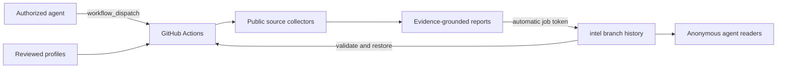

# GitHub-native agent research

## Archive compatibility hotfix — 2026-10-14

- Incident: scheduled run [38412787116](https://github.com/JsonLord/Horizon/actions/runs/38412787116), running main `3de83ea8b819436ab9be078aed3e18ede6033c33`, failed before collection and then attempted to upload a nonexistent archive. The shared archive had been last published by the newer PR #3 branch smoke run on October 9.
- Reproduced against the actual public archive using the deployed source: `Report` rejects the newer optional `schedule` field with Pydantic `extra_forbidden` during `history.restore`. The archive's evidence/checksums are valid. Raw hosted logs are inaccessible through the cloud network policy; the reproduction and GitHub run/step metadata establish the failure path.
- Added only the known optional schedule dictionary to the deployed report model and JSON Schema; arbitrary unknown report fields remain forbidden. Kept artifact identity, evidence and checksum validation intact. Existing archive reports are not rewritten or removed.
- Artifact upload now requires an archive manifest, preventing the secondary missing-files error when collection fails before restore completes. Genuine collection errors still fail the job.
- Updated this research workflow's actions to verified Node 24 implementations: checkout v5, setup-python v6, setup-uv v7, upload-artifact v6 and download-artifact v7. Pinned hosted runners to Ubuntu 24.04 to avoid the impending ubuntu-latest image switch. These maintenance changes address the warning/notice separately from the schema failure.
- Added four regression cases: mixed-schema publish/restore with unchanged artifact bytes, JSON tamper detection, Markdown tamper detection, and rejection of unknown fields. Before the fix, the three compatibility-dependent cases fail with the reproduced exception; afterwards all pass. Full main-based suite: **322 passed in 4.89s**. A fresh public restore succeeds at archive `93c38440da44f1ccdd3d0c2a7d1151a8266a9328`, retaining all five reports and the correct last-good ECB report.
- Added GitHub-hosted Python 3.11 regression and MCP smoke validation for this hotfix. Quoted the existing daily-summary GITHUB_ENV redirection so complete workflow lint with ShellCheck passes.
- Hosted Python 3.11 [regression run 38503116902](https://github.com/JsonLord/Horizon/actions/runs/38503116902) passed the complete suite and both MCP smoke checks (24 tools/nine profiles).
- Real hosted [smoke run 38503133662](https://github.com/JsonLord/Horizon/actions/runs/38503133662), source `295121bee2dadedf7e2c015b9849fe3fafbd8d7c`, succeeded: collect 28 seconds, publish 15 seconds using the automatic job token. No Node 20 deprecation or ubuntu-latest migration annotation remains; one nonfatal uv cache-reservation warning occurred because concurrent jobs attempted to save the same cache.
- Verified publication `ca38d37a08c0eab9a79b1ac3c3350a326e869df9` and report `4737b8c5720c499e9e95371b5a95eff5` under `intel/reports/institutions/ecb/2026/10/14/`: 17 findings, 18 sources, honestly partial coverage. Independent HTTP reads without Authorization verified both artifact lengths/SHA-256, source/run identity and comparison to prior snapshot `93c38440da44f1ccdd3d0c2a7d1151a8266a9328`; previous report hash is `eeb28d6b1b5c5bd793c42500b3cf29ff0a94c3c945dc3128e71450c8d8edcc9c`. JSON hash: `e984ee07421b622d2f7fc01c7eca102ea1b8967e3b296db66f1be3693c1dddc0`.
- [PR #4](https://github.com/JsonLord/Horizon/pull/4) is based directly on main, isolated from unmerged PR #3. Production code remains unchanged until authorized merge. PR #3 receives the same workflow maintenance and regression tests; its optional schedule field is already compatible.

The corrected root `spec.md` is the acceptance contract. This update continues PR #1 on `feat/agent-research`; scheduled and remote execution uses GitHub-hosted runners exclusively. Existing CLI, wizard, scrapers, deterministic fallback and local stdio MCP remain available for development.



## Implementation checklist

- [x] Remove deployment API/dashboard, hosted token and direct FastAPI dependencies; restore legacy CLI Docker files.
- [x] Preserve native tools and nine reviewed profiles; remote inputs contain only approved profile ID and bounded lookback.
- [x] Restore prior archive from `intel` before collection, validate checksums, record previous commit/report/hash and workflow provenance.
- [x] Test independent fresh runners, stable IDs and unchanged/updated/new classifications.
- [x] Discover and validate ECB and CERN feeds, reject stock-photo noise, prioritize primary institutional sources.
- [x] Validate WHO feed and document stale entries; document absent Helmholtz RSS discovery and add reviewed official-domain searches.
- [x] Complete regression, MCP, actionlint and public archive validation; Docker build outcomes recorded below.
- [ ] Push updated branch and PR; genuine Actions execution remains subject to default-branch workflow availability.

## Agent playbook

Use existing GitHub authorization to submit a reviewed profile. No application-specific credential exists. A new target requires a reviewed profile PR; remote dispatch does not accept prompts, URLs, headers or commands.

```sh
gh workflow run horizon-intel.yml --repo JsonLord/Horizon \
  -f profile_id=institutions/ecb -f lookback_hours=48
gh run list --repo JsonLord/Horizon --workflow horizon-intel.yml \
  --event workflow_dispatch --json databaseId,status,conclusion,headSha,url,createdAt
gh run watch RUN_ID --repo JsonLord/Horizon --exit-status
gh run view RUN_ID --repo JsonLord/Horizon --json status,conclusion,jobs,headSha,url
gh run download RUN_ID --repo JsonLord/Horizon --name research-archive
```

Dispatch does not return a run ID synchronously. Capture the dispatch time, select the matching event/branch/head SHA from the run list, and verify the archived report's `workflow.run_id` equals the selected GitHub run ID. A local research job ID is not a durable remote job handle. The report's `workflow.source_commit` identifies the code; `history.previous_snapshot_commit` identifies the baseline. A Git commit cannot contain its own commit SHA; obtain the publication commit from the branch history and workflow publisher output.

Unauthenticated consumers read:

- https://raw.githubusercontent.com/JsonLord/Horizon/intel/intel/manifest.json
- https://raw.githubusercontent.com/JsonLord/Horizon/intel/intel/latest/world.json
- https://raw.githubusercontent.com/JsonLord/Horizon/intel/intel/latest/world.md
- https://raw.githubusercontent.com/JsonLord/Horizon/intel/intel/latest/institutions/ecb.json

Find the entry with matching `workflow.run_id` in the index; fetch its `path`, adjacent `manifest.json` and Markdown. Verify artifact byte counts and SHA-256. For consistent reads, replace `intel` in the URL with the publication commit SHA. Historical reports are under `intel/reports/<profile>/YYYY/MM/DD/<report-id>/`; institutional changes are in `intel/events/YYYY/MM/DD/events.jsonl`. Schemas are under `schemas/` on the archive branch.

## Runtime and safeguards

The workflow runs daily at 06:23 UTC or by authorized dispatch; GitHub schedules may be delayed and only run from the default branch. Collector permission is `contents: read`; only the publisher has `contents: write`, using automatic `GITHUB_TOKEN`. Both jobs use `ubuntu-latest`, Python 3.11 and frozen uv installation. Concurrency serializes publication, timeouts bound execution, artifacts expire after seven days, and the archive retains 100 reports and 30 event dates. Publication retries three non-force pushes and merges freshly fetched history to preserve concurrent reports.

A missing archive branch is explicit bootstrap. Existing corrupt/missing manifests or unavailable remote history stop collection rather than falsely reporting all prior stories as new. Restoration uses the newest nonempty successful/partial profile report, skips failed/empty snapshots, and records the baseline timestamp so stale last-good history remains visible. Partial source failure (including GDELT 503) remains a report limitation. Latest pointers are reconstructed from validated versioned reports, never trusted as the comparison source. Optional compatible-model inference accepts only evidence-linked selections; deterministic mode needs no keys.

Local stdio tools run with `uv run horizon-mcp`. They retain profile discovery, local research submission/status, public archive search and report retrieval plus all legacy stage tools. Local job state is for that process, not a GitHub runner queue. Remote control uses GitHub's own API/CLI; no HTTP endpoints or listening ports are part of this architecture.

## Verification record

In progress. Prior public archive commits were published using cloud Git authorization, not an Actions job token. They are useful readable evidence, but do not verify automatic-token publishing. The new workflow must be recognized on the default branch before dispatch can be genuinely validated; this task does not authorize merging PR #1.

### Source validation (2026-10-09)

ECB's official RSS directory `https://www.ecb.europa.eu/home/html/rss.en.html` links `https://www.ecb.europa.eu/rss/press.html`: HTTP 200, valid RSS, 15 entries. CERN's homepage advertises `https://home.cern/feed/`: HTTP 200, valid RSS, 10 entries with institutional news titles. WHO's `https://www.who.int/rss-feeds/news-english.xml` returns HTTP 200, self-identifies its official feed URL and parses 25 entries; observed 2024 entries are stale and excluded by the bounded lookback. Its publishing page exposes no feed link; the attempted generic RSS directory returns 404. These three validated URLs are in reviewed profiles, with official-domain search queries as complementary sources.

Helmholtz English and German newsrooms return HTTP 200, but neither exposes an RSS/Atom link. The site's robots file points to sitemaps, not feeds. `/en/rss/` and `/en/newsroom/rss/` return 404. No unverified feed is configured. Its reviewed `site:helmholtz.de` query and institutional-name queries remain functional public-source collection; primary sources rank before secondary mentions. This is a source availability limitation, not a credential requirement.

### Current validation

- Frozen installation succeeds with `uv sync --frozen --extra dev`.
- Final full regression suite: **318 passed**, zero failed/skipped (see `/tmp/horizon-regression-new.log` for the current-instance log). This includes six new history/provenance/quality tests, independent day-1/day-2/day-3 directories, a separate archive consumer, checksum rejection and an actual competing Git push.
- Both MCP smoke checks pass; real stdio transport lists 24 tools and nine profiles.
- `actionlint` passes for `horizon-intel.yml`; Docker Compose configuration validates.
- Real archive restore verifies three historical reports at commit `6f82103fabc30fae344d58fe18991882621727fb`. Anonymous manifest, world JSON/Markdown and ECB JSON reads return HTTP 200. These historical reports predate workflow provenance fields; new reports/index entries include them.
- Dispatch attempt returns HTTP 404 for `horizon-intel.yml`, which is not on the default branch. No genuine Actions run ID or automatic-token publication is claimed. No merge is performed.
- Docker normal build and host-network retry both fail DNS while fetching locked dependencies from `files.pythonhosted.org`; neither image build is claimed successful. Native frozen installation and CLI/MCP verification remain valid. Legacy `horizon --help` succeeds. The interactive wizard has no `--help` parser and reaches its existing prompt before EOF in this noninteractive check; its regression tests pass, and no wizard source was changed.

The cloud environment draft now contains frozen development installation and CLI/MCP/Actions instructions without a persistent service. Deployment-only domains were removed. Saving the draft does not publish the environment; review and publish it through environment settings when desired.

### Live fresh-output collection

A credential-free local development check restored the verified public archive and collected `institutions/ecb` with a 48-hour window. Report `6826e2dd61e4402bbd2aeca7f1fa8831` is partial with 23 findings/27 sources: 10 unchanged, two updated, 11 new. Google News official-domain and institutional queries plus RSS succeeded; GDELT returned HTTP 503. The report records prior report `65452eb59f454da3884b3e3583d57207`, SHA-256 `5450c4f49413e147d8d06f65414192c1d225262f3076c6ae1ceb62842dc90121`, baseline archive commit and stale-last-good=false. This local check is **not** an Actions run or newly published public result.

### Changed files

Removed `src/api/__init__.py`, `src/api/app.py`, `deploy/huggingface/README.md` and the HTTP-only `tests/test_research_http.py`. Added `src/research/history.py` and `tests/test_research_history.py`. Updated workflow, root spec, README, this record, legacy Dockerfile/Compose, dependency declaration/lockfile, four institution profiles, report schema, research analyzer/CLI/publisher/reporting/service and the registration fixture. Existing scrapers, model fallback, CLI/wizard, all 24 stdio MCP tools and public archive reader are retained.

Remaining acceptance blockers: genuine workflow dispatch/publication requires the workflow to exist on the default branch and Actions write permissions/branch policy to allow `intel` publication. Dispatch currently returns 404, so no real run IDs or conclusions exist for this new workflow. The updated PR stays unmerged. Helmholtz has no validated discoverable feed; public search coverage is explicitly limited. Legacy Docker image build is blocked by this environment's Docker DNS. No hosted deployment is planned.

## Funding Gate 1 — 2026-10-21

Target: `feature/program-intelligence-implementation` (the attached Gate 1 names
no alternative branch). Existing unfinished program work was preserved in a
separate checkpoint commit before funding integration.

Implemented:

- Funding-specific profile and public URL register; applicant facts default to
  unknown. Deterministic hard restrictions are separate from relevance scores.
- Validated official resources, quotation/hash/date provenance, typed claims,
  application status, eligibility status, explicit deadline tokens and freshness.
- Stable-ID opportunity folders, exactly one current overview, deterministic
  supporting documents/indexes, archived/review/active separation and append-only
  history with old source references. Deadline changes rename the existing folder.
- Common storage adapter keeps the existing intel/MCP report contract and adds
  optional entity-folder projections. CLI supports collection, reviewed imports,
  regeneration and drift checking. AGENTS.md documents sites and agent controls.

Evidence limitation: normal HTTPS requests to the candidate IBB, KfW and European
Commission URLs returned proxy `403 Forbidden` on 2026-10-21. They are candidate
URLs, not verified program facts. No example deadline, funding amount, application
status or eligibility decision is asserted. All three remain review-required.
No full pages, documents, secrets or private inputs have been committed.

Validation completed on 2026-10-21:

- `uv sync --frozen --extra dev`: successful, no dependency/lockfile changes.
- Full regression: **378 passed in 3.06s**, including **25 funding tests**.
- Stdio MCP smoke: **24 tools, 11 profiles, success**.
- Legacy MCP smoke: **success** using the existing ignored example config.
- Funding generation drift check: **passed**; 3 review-required candidates,
  0 verified active and 0 archived records. All generated navigation links exist.
- Existing publisher -> temporary bare `intel` Git remote -> separate clone and
  archive validation: **passed** (synthetic evidence only inside temporary tests).
- `actionlint` 1.7.7: **passed** for all repository workflows; downloaded official
  release SHA-256 verified. The system `go` executable was not the Go toolchain,
  so the verified release binary was used instead.
- Staged whitespace check: **passed**.

A network draft was saved adding `www.ibb.de`, `www.ibb-business-team.de`,
`www.kfw.de`, `eic.ec.europa.eu`, `ec.europa.eu`, preserving existing allowed
hosts. The tool reports `requires_publish: true`; saving the draft does not apply
runtime access. Live official-term verification remains blocked until that
configuration is reviewed, saved and published in environment settings.

No production merge, schedule activation, Hugging Face deployment, secrets change
or external intel publication was performed. The existing public `intel` branch
was observed at `9eea5d06695c05f2c63738967ef31539974ba239`; no funding publication
to that branch is claimed. HTTP serving is outside this GitHub-only Gate 1.
The available agent interface remains stdio MCP. The local publication acceptance
path is `intel/reports/funding/de-eu/YYYY/MM/DD/<report_id>/report.json` with a
useful-report pointer at `intel/latest/funding/de-eu.json` (and Markdown).

Gate 1 storage and compatibility acceptance tests are complete. The definition
of done's live evidence-backed opportunity content is **not complete**: all
candidate deadlines, financial terms and eligibility remain explicitly unknown.
Do not activate or advertise these candidates as verified funding offers.

Files created or modified for this gate:


- `.github/workflows/research-validation.yml`
- `.gitignore`
- `AGENTS.md`
- `Funding DK (DE missing).md`
- `README.md`
- `config/funding-applicant.json`
- `config/funding-sources.json`
- `docs/agent-research.md`
- `profiles/funding/de-eu.json`
- `research/funding-de-eu/ACTIVE_OPPORTUNITIES.md`
- `research/funding-de-eu/ARCHIVED_OPPORTUNITIES.md`
- `research/funding-de-eu/README.md`
- `research/funding-de-eu/REVIEW_REQUIRED.md`
- `research/funding-de-eu/index.json`
- `research/funding-de-eu/opportunities/EU__EIC-Accelerator__UNKNOWN/00_OVERVIEW__ELIGIBILITY_UNKNOWN__UNKNOWN.md`
- `research/funding-de-eu/opportunities/EU__EIC-Accelerator__UNKNOWN/application-guide.md`
- `research/funding-de-eu/opportunities/EU__EIC-Accelerator__UNKNOWN/benefits-and-costs.md`
- `research/funding-de-eu/opportunities/EU__EIC-Accelerator__UNKNOWN/change-history.jsonl`
- `research/funding-de-eu/opportunities/EU__EIC-Accelerator__UNKNOWN/eligibility.md`
- `research/funding-de-eu/opportunities/EU__EIC-Accelerator__UNKNOWN/evidence.md`
- `research/funding-de-eu/opportunities/EU__EIC-Accelerator__UNKNOWN/opportunity.json`
- `research/funding-de-eu/opportunities/EU__EIC-Accelerator__UNKNOWN/required-documents.md`
- `research/funding-de-eu/opportunities/EU__EIC-Accelerator__UNKNOWN/resources/README.md`
- `research/funding-de-eu/opportunities/EU__EIC-Accelerator__UNKNOWN/resources/links.json`
- `research/funding-de-eu/opportunities/EU__EIC-Accelerator__UNKNOWN/sources.json`
- `research/funding-de-eu/opportunities/IBB__GruendungsBONUS-Plus__UNKNOWN/00_OVERVIEW__ELIGIBILITY_UNKNOWN__UNKNOWN.md`
- `research/funding-de-eu/opportunities/IBB__GruendungsBONUS-Plus__UNKNOWN/application-guide.md`
- `research/funding-de-eu/opportunities/IBB__GruendungsBONUS-Plus__UNKNOWN/benefits-and-costs.md`
- `research/funding-de-eu/opportunities/IBB__GruendungsBONUS-Plus__UNKNOWN/change-history.jsonl`
- `research/funding-de-eu/opportunities/IBB__GruendungsBONUS-Plus__UNKNOWN/eligibility.md`
- `research/funding-de-eu/opportunities/IBB__GruendungsBONUS-Plus__UNKNOWN/evidence.md`
- `research/funding-de-eu/opportunities/IBB__GruendungsBONUS-Plus__UNKNOWN/opportunity.json`
- `research/funding-de-eu/opportunities/IBB__GruendungsBONUS-Plus__UNKNOWN/required-documents.md`
- `research/funding-de-eu/opportunities/IBB__GruendungsBONUS-Plus__UNKNOWN/resources/README.md`
- `research/funding-de-eu/opportunities/IBB__GruendungsBONUS-Plus__UNKNOWN/resources/links.json`
- `research/funding-de-eu/opportunities/IBB__GruendungsBONUS-Plus__UNKNOWN/sources.json`
- `research/funding-de-eu/opportunities/KfW__ERP-StartGeld__UNKNOWN/00_OVERVIEW__ELIGIBILITY_UNKNOWN__UNKNOWN.md`
- `research/funding-de-eu/opportunities/KfW__ERP-StartGeld__UNKNOWN/application-guide.md`
- `research/funding-de-eu/opportunities/KfW__ERP-StartGeld__UNKNOWN/benefits-and-costs.md`
- `research/funding-de-eu/opportunities/KfW__ERP-StartGeld__UNKNOWN/change-history.jsonl`
- `research/funding-de-eu/opportunities/KfW__ERP-StartGeld__UNKNOWN/eligibility.md`
- `research/funding-de-eu/opportunities/KfW__ERP-StartGeld__UNKNOWN/evidence.md`
- `research/funding-de-eu/opportunities/KfW__ERP-StartGeld__UNKNOWN/opportunity.json`
- `research/funding-de-eu/opportunities/KfW__ERP-StartGeld__UNKNOWN/required-documents.md`
- `research/funding-de-eu/opportunities/KfW__ERP-StartGeld__UNKNOWN/resources/README.md`
- `research/funding-de-eu/opportunities/KfW__ERP-StartGeld__UNKNOWN/resources/links.json`
- `research/funding-de-eu/opportunities/KfW__ERP-StartGeld__UNKNOWN/sources.json`
- `schemas/funding-applicant.schema.json`
- `schemas/funding-dataset.schema.json`
- `schemas/funding-opportunity.schema.json`
- `schemas/profile.schema.json`
- `schemas/research-report.schema.json`
- `scripts/check_research_mcp.py`
- `scripts/research_funding.py`
- `src/research/funding/__init__.py`
- `src/research/funding/models.py`
- `src/research/funding/pipeline.py`
- `src/research/funding/storage.py`
- `src/research/output_storage.py`
- `src/research/profiles.py`
- `src/research/publisher.py`
- `src/research/reporting.py`
- `src/research/service.py`
- `tests/test_funding.py`
- `tests/test_research.py`


Hosted verification observed on 2026-10-22 (Europe/Berlin): code commit
`c8797d90a884294a9938579afe7df57883ec45ed` passed both push regression
[39684017852](https://github.com/JsonLord/Horizon/actions/runs/39684017852) and PR
regression [39684023925](https://github.com/JsonLord/Horizon/actions/runs/39684023925).
The GitHub API reports both completed/success. Hosted log downloads are denied
by the proxy at `results-receiver.actions.githubusercontent.com`, so hosted test
counts were not independently read. The public intel tip remains
`9eea5d06695c05f2c63738967ef31539974ba239`. Runtime configuration still lacks the
saved funding-domain additions. PR #5 remains a draft; no activation is claimed.

## Funding source verification — 22 October 2026 (Europe/Berlin)

See [the complete diagnosis and source review](funding-source-verification.md).
All three original official URLs now return proxy CONNECT 200 / HEAD 200, and
robots-permitted operator GET requests retrieved their content. The earlier
CONNECT 403 identifies a proxy-path failure but not the original denying rule or
component. Current local DNS failure is a separate, confirmed collector blocker;
Horizon now reports `local_dns_unavailable` and retains its DNS/SSRF protections.
No network draft or runtime setting was changed. Read-only draft inspection found
five effective destination additions, 148 redundant custom copies, no removals,
and unchanged restricted mode/preset; current proxy behavior cannot be inferred
from the policy snapshot, whose state remains unknown.

Updated all three structured opportunities and their generated evidence, source
registers, supporting Markdown, histories and dashboards. IBB and KfW guideline
PDFs were verified in temporary storage with short quoted evidence and SHA-256
fingerprints retained. EIC's full-proposal-only cutoff is 2026-11-04, 17:00
Europe/Brussels, requiring a short-proposal GO; its folder was renamed while
preserving ID/history. Other deadlines remain unknown. All three applicant
classifications remain ELIGIBILITY_UNKNOWN and the active shortlist remains zero.

Added read-only diagnostics, strict header filtering, additive-schema history
checksum compatibility and stale-evidence protections. A manual Actions
qualification mode runs two fresh service instances with explicit restoration of
the first execution's folder/intel trees, no publisher and read-only permissions.
This is two executions inside one GitHub-hosted job, not two separate runners.

Pre-hosted validation: **384 tests passed in 2.96s**, including **31 funding
tests**; both MCP smoke checks passed (24 tools/11 profiles), deterministic funding
regeneration passed, actionlint 1.7.7 passed, whitespace checks passed. Production
intel remains `9eea5d06695c05f2c63738967ef31539974ba239`. Hosted qualification results
will be recorded after execution. PR #5 remains in draft.


### Hosted funding milestone completed

The first qualification (run 39714929750) failed; logs were inaccessible through
this environment's proxy. Added bounded public failure annotations rather than
changing network settings. Run 39715118888 then identified KfW's exact collector
error: `Public HTTPS URL required`; IBB and EIC collected successfully. The
collector had stripped the trailing slash from the official KfW request URL,
which caused the server to issue an HTTP redirect. Preserving the reviewed HTTPS
request path and exact returned evidence URL fixed that routing error. HTTP
downgrades remain rejected, with explicit regression tests.

[Run 39715311269](https://github.com/JsonLord/Horizon/actions/runs/39715311269)
**succeeded** against code commit `68ef93b5649cdc9822133530622fecd43bd0ebc5`.
The public check-run annotation contains the complete bounded proof, preserved
in [funding-qualification-2026-10-22.json](funding-qualification-2026-10-22.json):

- Two complete executions, each freshly collected all three official pages with
  no collection errors under the existing DNS/HTTPS/robots/size guards.
- Report `e16375deda9141ab92ff3f0daf624ace` was restored as the comparison source
  for `d751f73b77124aa588bcc178cdb9285b`.
- EIC/IBB/KfW histories increased respectively 4->5, 3->4, 4->5 events; stable IDs,
  folder names, scoped deadlines and eligibility statuses remained consistent.
- Both projections regenerated deterministically, retained one overview per
  opportunity and showed 0 active / 3 review-required entries.
- `collect`, `publish` and `program-qualify` jobs were skipped. The artifact upload
  succeeded. This proves consecutive executions within one hosted job, not
  separate workflow runs or distinct fresh runners.

Final code validation: **386 tests passed in 3.02s**, including **33 funding tests**;
program verification tests, both MCP smoke checks, deterministic output validation
and actionlint passed. Local DNS remains unavailable; the default collector keeps
failing closed there. No website refusal is established by historical proxy
CONNECT errors. No network settings changed, no eligibility promotion occurred,
and the historical exact denying component remains unknown. PR #5 stays draft.

Affected tracked paths for this verification milestone (including the EIC folder rename):

- `.github/workflows/horizon-intel.yml`
- `AGENTS.md`
- `README.md`
- `docs/agent-research.md`
- `docs/funding-source-verification.md`
- `research/funding-de-eu/REVIEW_REQUIRED.md`
- `research/funding-de-eu/index.json`
- `research/funding-de-eu/opportunities/EU__EIC-Accelerator__2026-11-04/00_OVERVIEW__ELIGIBILITY_UNKNOWN__2026-11-04.md`
- `research/funding-de-eu/opportunities/EU__EIC-Accelerator__2026-11-04/application-guide.md`
- `research/funding-de-eu/opportunities/EU__EIC-Accelerator__2026-11-04/benefits-and-costs.md`
- `research/funding-de-eu/opportunities/EU__EIC-Accelerator__2026-11-04/change-history.jsonl`
- `research/funding-de-eu/opportunities/EU__EIC-Accelerator__2026-11-04/eligibility.md`
- `research/funding-de-eu/opportunities/EU__EIC-Accelerator__2026-11-04/evidence.md`
- `research/funding-de-eu/opportunities/EU__EIC-Accelerator__2026-11-04/opportunity.json`
- `research/funding-de-eu/opportunities/EU__EIC-Accelerator__2026-11-04/required-documents.md`
- `research/funding-de-eu/opportunities/EU__EIC-Accelerator__2026-11-04/resources/README.md`
- `research/funding-de-eu/opportunities/EU__EIC-Accelerator__2026-11-04/resources/links.json`
- `research/funding-de-eu/opportunities/EU__EIC-Accelerator__2026-11-04/sources.json`
- `research/funding-de-eu/opportunities/EU__EIC-Accelerator__UNKNOWN/00_OVERVIEW__ELIGIBILITY_UNKNOWN__UNKNOWN.md`
- `research/funding-de-eu/opportunities/EU__EIC-Accelerator__UNKNOWN/application-guide.md`
- `research/funding-de-eu/opportunities/EU__EIC-Accelerator__UNKNOWN/benefits-and-costs.md`
- `research/funding-de-eu/opportunities/EU__EIC-Accelerator__UNKNOWN/change-history.jsonl`
- `research/funding-de-eu/opportunities/EU__EIC-Accelerator__UNKNOWN/eligibility.md`
- `research/funding-de-eu/opportunities/EU__EIC-Accelerator__UNKNOWN/evidence.md`
- `research/funding-de-eu/opportunities/EU__EIC-Accelerator__UNKNOWN/opportunity.json`
- `research/funding-de-eu/opportunities/EU__EIC-Accelerator__UNKNOWN/resources/links.json`
- `research/funding-de-eu/opportunities/EU__EIC-Accelerator__UNKNOWN/sources.json`
- `research/funding-de-eu/opportunities/IBB__GruendungsBONUS-Plus__UNKNOWN/00_OVERVIEW__ELIGIBILITY_UNKNOWN__UNKNOWN.md`
- `research/funding-de-eu/opportunities/IBB__GruendungsBONUS-Plus__UNKNOWN/application-guide.md`
- `research/funding-de-eu/opportunities/IBB__GruendungsBONUS-Plus__UNKNOWN/benefits-and-costs.md`
- `research/funding-de-eu/opportunities/IBB__GruendungsBONUS-Plus__UNKNOWN/change-history.jsonl`
- `research/funding-de-eu/opportunities/IBB__GruendungsBONUS-Plus__UNKNOWN/eligibility.md`
- `research/funding-de-eu/opportunities/IBB__GruendungsBONUS-Plus__UNKNOWN/evidence.md`
- `research/funding-de-eu/opportunities/IBB__GruendungsBONUS-Plus__UNKNOWN/opportunity.json`
- `research/funding-de-eu/opportunities/IBB__GruendungsBONUS-Plus__UNKNOWN/resources/links.json`
- `research/funding-de-eu/opportunities/IBB__GruendungsBONUS-Plus__UNKNOWN/sources.json`
- `research/funding-de-eu/opportunities/KfW__ERP-StartGeld__UNKNOWN/00_OVERVIEW__ELIGIBILITY_UNKNOWN__UNKNOWN.md`
- `research/funding-de-eu/opportunities/KfW__ERP-StartGeld__UNKNOWN/application-guide.md`
- `research/funding-de-eu/opportunities/KfW__ERP-StartGeld__UNKNOWN/benefits-and-costs.md`
- `research/funding-de-eu/opportunities/KfW__ERP-StartGeld__UNKNOWN/change-history.jsonl`
- `research/funding-de-eu/opportunities/KfW__ERP-StartGeld__UNKNOWN/eligibility.md`
- `research/funding-de-eu/opportunities/KfW__ERP-StartGeld__UNKNOWN/evidence.md`
- `research/funding-de-eu/opportunities/KfW__ERP-StartGeld__UNKNOWN/opportunity.json`
- `research/funding-de-eu/opportunities/KfW__ERP-StartGeld__UNKNOWN/required-documents.md`
- `research/funding-de-eu/opportunities/KfW__ERP-StartGeld__UNKNOWN/resources/links.json`
- `research/funding-de-eu/opportunities/KfW__ERP-StartGeld__UNKNOWN/sources.json`
- `schemas/funding-dataset.schema.json`
- `schemas/funding-opportunity.schema.json`
- `scripts/qualify_funding.py`
- `scripts/research_funding.py`
- `src/research/funding/diagnostics.py`
- `src/research/funding/models.py`
- `src/research/funding/pipeline.py`
- `src/research/funding/storage.py`
- `src/research/programs/fetch.py`
- `tests/test_funding.py`
- `docs/funding-qualification-2026-10-22.json` (new public hosted proof)

## Authored funding document as workflow starting point — 22 October 2026

The user-added `research/funding-de-eu/Funding DK (DE missing).md` was absent from
this local checkout but available on the public implementation branch. Imported
that exact public file, preserving its bytes and SHA-256
`5a509f585d1e05eb996ab13bdff83064ea708f08db03ea4bfd79c22fe0d5ee65`.
It remains an authored/historical research input, not a generated dashboard or
verified current terms. Full design and commands are documented in
[funding-document-workflow.md](funding-document-workflow.md).

Implemented a seed-driven queue and maintenance workflow with reviewed public
DK/Berlin/DE/EU search queries and existing official-source refresh. The final
initial deduplicated queue has **100 research references**: 36 requiring official
source review, 57 requiring source discovery, 7 referring to tracked programs.
The first pass had seven malformed duplicate URL references; parsing was corrected
and tested before the final queue was generated. Historical deadlines and source
prose are never converted to current claims, applicant facts or outbound prompts.

Added `.github/workflows/funding-research.yml`, `config/funding-research.json`,
`scripts/funding_research.py`, `src/research/funding/research.py`, queue/policy
schemas, generated queue/navigation and agent instructions. Official source/domain
approval is separate from nomination; approving a source enables the next refresh
to create its folder through existing storage. The source document is never
rewritten by automation. Root and funding dashboards regenerate consistently.

The workflow supports manual research and read-only development runs on relevant
pushes to the implementation branch. Scheduled research and automated review PRs
remain disabled in policy. The optional default-branch writer validates source
SHA, seed fingerprint, typed data and approved identities, ignores artifact code
and Markdown, and creates a new data-only draft PR with GITHUB_TOKEN. No existing
ref is overwritten, force-pushed or auto-merged; the production archive is not a
publication target. An existing funding proposal remains pending human review.

Validation: **407 tests passed in 4.00s**, including **21 new document-workflow
tests** covering privacy, historical-date handling, deduplication, discovery
outages, stale provenance, unauthorized sources, data-only writes, disabled/branch
write guards, draft PR creation and URL markup escaping. Both MCP smoke checks
passed (24 tools / 11 profiles), funding checks and source-index validation passed,
and actionlint passed. No dependencies, credentials, public ports or network
settings were added or changed.

A real local discovery run returned four new funding-related public-search
nominations, bringing the stored queue to 104 references. All three reviewed
Google News queries succeeded. Search headlines remain explicitly unverified;
no source was auto-approved and no eligibility decision changed. Real collection
exposed and fixed HttpUrl normalization and the harmless numeric Google News RSS
`oc` parameter; credentials/other query parameters remain rejected. General
innovation news without a funding signal is filtered. The official-source refresh
failed locally with public-DNS unavailable; historical evidence was retained and
the failed refresh was not applied to the committed opportunity records.

GitHub authentication was initially unavailable (401), but recovered on resume.
Fetched remote commit `4176ea47617bda64a789da31e77f8da78452da87`: its only change
is the authored source file, whose SHA matches the preserved local copy exactly.
Reconcile that commit before a regular push. A robots-file request to the candidate
Innobooster operator returned proxy CONNECT 403; that nomination was not promoted
or added to the approved source register. No network settings changed. The earlier
successful qualification does not validate this new workflow; record its new live
run separately. No merge, production schedule activation or archive publication
was performed in this milestone.

Read-only hosted workflow `39792085703` created the funding-update artifact and
skipped the privileged proposal job. Artifact content retrieval is blocked by the
execution environment's artifact-host policy (403); network policy was not
changed. Added a bounded public Actions annotation (IDs, source/seed hashes,
refresh statuses, nomination counts and public deadline metadata only) to permit
independent verification over GitHub API without copying source prose, search
headlines or transport errors. A regression test covers that output contract.

The proof remains within the annotation ceiling for the full supported 40-program
registry: aggregate counts cover all records, per-program details are limited to
eight with an explicit truncation flag, and search metrics are re-sanitized.

### Hosted outcome

Regular pushes preserved upload commit `4176ea4`; the implementation and bounded
proof changes are on the existing draft PR #5. The initial new-workflow run
[39792085703](https://github.com/JsonLord/Horizon/actions/runs/39792085703) passed,
as did push/PR regressions 39792085647 / 39792096346. Follow-up run
[39792501009](https://github.com/JsonLord/Horizon/actions/runs/39792501009) produced
an independently retrieved Actions proof notice: 100 authored references plus
4 public-search nominations, all 3 Google News queries OK; KfW refresh OK, IBB
and EIC refresh incomplete/review-required, report partial. False refresh flags
do not establish whether transport or changed terms caused the incomplete refresh;
the full artifact is inaccessible from this environment. All three eligibility
checks remain incomplete, deadlines remain null / null / 2026-11-04 respectively.
The collect check completed successfully and privileged proposal was skipped.
Push/PR regressions 39792500969 / 39792507648 passed. Public machine proof is
`docs/funding-document-hosted-proof-2026-10-22.json`.

The committed opportunity store was not replaced with the partial proposal.
No production archive writes, schedule activation, PR merge or network changes
occurred. The latest bounded-proof-only refinement is `b66ffd4`; its hosted
follow-up is recorded separately once complete.

A separate consumer read `research/funding-de-eu/RESEARCH_QUEUE.json` through the
GitHub contents API at `b66ffd43f495d967aaa3b315e4cebd25a3931834`, verifying all
104 references, four search nominations and the original seed hash. Both hosted
regressions on that revision passed (39792869592 / 39792875704). The bounded-proof
collection follow-up `39792869602` was still queued at this documentation update;
that pending state is not recorded as success.

Files for this milestone: `.github/workflows/funding-research.yml`,
`.github/workflows/research-validation.yml`, `AGENTS.md`, repository-root funding
dashboard, `README.md`, `config/funding-research.json`, `profiles/funding/de-eu.json`,
funding KB README/queue/update Markdown, funding policy/queue JSON schemas,
`scripts/funding_research.py`, `scripts/research_funding.py`,
`src/research/funding/research.py`, `src/research/funding/storage.py`,
`tests/test_funding_research.py`, this log, workflow guide and public proof JSON.
The user's nested authored source file is preserved unchanged.

Final confirmation: GitHub API reports the bounded-proof follow-up
[39792869602](https://github.com/JsonLord/Horizon/actions/runs/39792869602)
**completed / success** on `b66ffd43f495d967aaa3b315e4cebd25a3931834`.
That resolves the queued state above. Its per-job/annotation endpoints still
returned earlier snapshots at final inspection; the independently retrieved
content proof remains the explicitly identified run 39792501009, not a claim
that the latest artifact contents were downloaded. Final code regressions passed,
working tree was clean before documentation, and PR #5 remains draft.

## Funding acceptance gates — 22 October 2026

User supplied the Funding Research Acceptance & Hosted Qualification task.
Independently reconfirmed a549be1 / draft PR #5, previous hosted success
39792869602 and its skipped proposal job. Baseline: 407 passed in 3.98s;
legacy/stdio MCP (24 tools / 11 profiles), funding consistency and actionlint pass.
Local HEAD diagnostics at 14:20 UTC returned 200 for all three official pages;
public DNS is unavailable locally, so the existing collector remains fail-closed.
No network settings or credentials changed.

Added opt-in, read-only `funding_acceptance` qualification to existing
horizon-intel workflow. It seals a public-data snapshot without authored notes or
job bookkeeping, restores a same-revision prior hosted artifact, validates all
checksums/paths/history, rechecks every source, verifies deterministic projection,
and simulates/rejects a partial working-tree write before restoring the sealed
checkpoint. This tests checkpoint recovery, not SIGKILL atomicity. Public notices
provide bounded independently retrievable evidence. Added optional native-model
429/500/502/503 and transport retries (three attempts, bound input hash, bounded
backoff); schema/identity failures do not retry and retain deterministic fallback.
Initial focused checks: 21 passed (funding acceptance + model tests). Hosted
qualification and remaining acceptance gates are in progress, not yet PASS.

### Funding acceptance outcome — 23 October 2026

Two **independent workflow dispatches** succeeded on immutable source b30b6b6:
39795621057 (22 October) and 39934478478 (23 October), with different GitHub-hosted
runner instance names. Run 2 restored real snapshot artifact 12433950391; the
ZIP digest matches GitHub artifact metadata and the manifest hash matches run 1.
It used run 1's report for comparison; histories EIC 4→5, IBB 3→4, KfW 4→5,
without lost reviewed claims/deadlines or duplicate events. The simulated partial
working-manifest write was rejected and the sealed checkpoint restored exactly;
this is not a SIGKILL atomicity claim. Production collect/publish jobs skipped.
Public proofs were retrieved via check-run annotations and saved in
`funding-acceptance-run-1.json`, `funding-acceptance-run-2.json` and
`funding-durability-qualification.json`. Full artifacts were not downloaded locally.

IBB/EIC original partial status was **official_terms_need_reverification**:
full-page hashes changed while every previously cited page quotation remained
present. Both pages were actually accessible. On run 2 KfW also changed its raw
page hash and conservatively required review. Rechecked quote resources with the
actual 23 October observations were added to all three folders; historical
resources/events remain. Founder-scenario explanations distinguish IBB's required
completed establishment from EIC's natural-person short-proposal path / full GO
gate. Uncited conditions and complete applicant eligibility remain unresolved;
all three stay ELIGIBILITY_UNKNOWN and active count stays zero. EIC full cutoff
remains 4 November 2026 17:00 Europe/Brussels; IBB/KfW deadlines remain UNKNOWN.
Original authored source SHA remains 5a509f585d1e05eb996ab13bdff83064ea708f08db03ea4bfd79c22fe0d5ee65.

All four public nominations were rechecked; article paths refused robots access.
Four independent public RSS alternatives returned 200 but only news/aggregator
references. No official canonical program URL, eligibility, condition or deadline
was guessed. NOMINATION_REVIEWS records all four as pending, with reason codes;
zero accepted/rejected/promoted. Shared storage now displays scenario/source
review claims and nomination-review navigation. The new read-only audit validates
required files, immutable checksummed history and 43 internal links; future new
nominations default to pending rather than breaking the workflow.

Controlled generated-data PR transport was factored into a common, guarded
writer: stable owned marker, data-only paths, base/head SHA checks, non-force
updates, no-change zero writes, no adoption of unowned or legacy branches, and
full-tree removal of obsolete deadline folders. A real operator-authorized live
qualification created **draft PR #6** against isolated
`automation/funding-acceptance-base-b30b6b66ac18`, updated only queue JSON/Markdown,
reused the same PR without duplicate/force and repeated with zero writes. The
harness itself was repeated successfully. Its original empty baseline created no
PR. Proof: `funding-review-qualification.json`. It used the existing operator
identity, **not** automatic Actions GITHUB_TOKEN. Main-branch API reports
`protected: false`; no branch protection was changed. HTTP 403/422 protections
and racing heads are tested, not falsely reported as live production failures.
The production proposal job remains disabled by both policy and main-ref guards.

Both hosted model probes discovered the real native Laya contract but structured
inference did not succeed after three attempts; deterministic fallback remained
review-only and uncalibrated, with null probability. No private narrative or
applicant facts were sent. No successful inference or exact upstream cause is
invented. Funding rules do not consume/override eligibility with semantic scores.

Final implementation tests: **432 passed in 5.11s** (0 failing), including funding,
review, recovery and model regression checks. Both MCP smokes passed (24 tools /
11 profiles); funding consistency, 43-link folder audit and source-index checks
passed. actionlint 1.7.7 passed after re-downloading the official tool and checking
its release SHA-256 (the resumed temporary binary was absent). Acceptance table,
source timestamps, actual run URLs and exact remaining limits are in
`FUNDING_RESEARCH_ACCEPTANCE.md`. Final hosted regressions are being checked on
1f91795 before calling that gate complete. No merge, schedule activation,
production intel write, credential/network change or force-push occurred.


Final log-safety hardening: artifact restore failures discard signed redirect URLs,
upstream response bodies and chained transport details. A negative test covers
secret-bearing error context. Local full suite advanced to 433 passed; the explicit
automatic-token sandbox mode and its main-ref/policy-error tests bring the final
suite to **435 passed in 4.74s**. No failing tests remain; actionlint passes.

Code 1f91795 passed hosted push/PR regressions 39937114243 / 39937120258 and normal
read-only funding maintenance 39937114312. The signed-URL fix is a690a26.
Additional opt-in job-token sandbox qualification is bdf7d83: explicit authorized
workflow_dispatch on this implementation branch only, dedicated contents/PR-write
job, data-only isolated acceptance base/head names; rejects main and mismatched
source revision. Normal production collect/publish is skipped for that flag.
The workflow requests no new external credential and changes no repository or
network policy. The writer records known GitHub permission-policy errors using
static reason codes, never raw API bodies. Its real job-token outcome is pending
and must not be inferred from successful operator PR #6.


Final automatic-token result: run **39990565222**, check 120540936023, completed
its isolated test and emitted a **BLOCKED** PR-publication proof. The actual
failure is POST /pulls HTTP 403, specifically actions_pr_creation_disabled
(GitHub Actions cannot create/approve pull requests). This is not inferred from
a skipped job or successful operator authentication. It did create isolated
sandbox refs before the PR request; no PR exists for that head, only queue
JSON/Markdown differ, and no production branch was touched. Those refs remain
for manual reconciliation rather than automatic adoption/overwrite. A read of
Actions workflow permission settings by the existing operator integration also
returned HTTP 403 Resource not accessible by integration; enforcement location
(repository/organization) cannot be established. No permission was changed.
Evidence: funding-review-token-qualification.json. Gate E is PARTIAL, not PASS.

Final code bdf7d83 passed hosted push regression 39990560292 and PR regression
39990570621. Signed-URL patch regressions 39989900641 / 39989909381 passed.
Final gate results: A PARTIAL, B PARTIAL, C PASS, D PASS, E PARTIAL, F PARTIAL,
G PASS (checks/report completed, not production/research approval). PR #5 remains
draft, ready for funding technical review with explicit external blockers.
Local final suite: 435 passed in 4.74s; all MCP, consistency, navigation, index
and lint checks passed. No merge, force push, schedule activation, intel
publication or network/secrets/repository permission change was performed.


Final generic-model inspection found the separate OpenAI-compatible selector had
safe fallback but no transient retries. Added three bounded attempts for
429/500/502/503/transport failures, without mutating findings until response
validation. Four new tests verify identical retries, evidence preservation and
sanitized fallback. No generic endpoint/model/key is configured; direct enrich([])
returns deterministic fallback with no inference. Final suite is **439 passed in
5.06s**; both MCP smoke checks, funding consistency, navigation/index checks and
workflow lint were rerun and passed after that code change. Final code 805028e
passed push regression **39991873667** and PR regression **39991878771**. The
native-model live failure and GitHub-token PR policy block remain explicitly
partial; no success is inferred from those completed qualification jobs.
