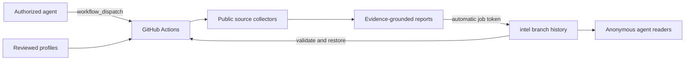

# GitHub-native agent research

## Archive compatibility hotfix — 2026-10-14

- Incident: scheduled run [38412787116](https://github.com/JsonLord/Horizon/actions/runs/38412787116), running main `3de83ea8b819436ab9be078aed3e18ede6033c33`, failed before collection and then attempted to upload a nonexistent archive. The shared archive had been last published by the newer PR #3 branch smoke run on October 9.
- Reproduced against the actual public archive using the deployed source: `Report` rejects the newer optional `schedule` field with Pydantic `extra_forbidden` during `history.restore`. The archive's evidence/checksums are valid. Raw hosted logs are inaccessible through the cloud network policy; the reproduction and GitHub run/step metadata establish the failure path.
- Added only the known optional schedule dictionary to the deployed report model and JSON Schema; arbitrary unknown report fields remain forbidden. Kept artifact identity, evidence and checksum validation intact. Existing archive reports are not rewritten or removed.
- Artifact upload now requires an archive manifest, preventing the secondary missing-files error when collection fails before restore completes. Genuine collection errors still fail the job.
- Updated this research workflow's actions to verified Node 24 implementations: checkout v5, setup-python v6, setup-uv v7, upload-artifact v6 and download-artifact v7. Pinned hosted runners to Ubuntu 24.04 to avoid the impending ubuntu-latest image switch. These maintenance changes address the warning/notice separately from the schema failure.
- Added four regression cases: mixed-schema publish/restore with unchanged artifact bytes, JSON tamper detection, Markdown tamper detection, and rejection of unknown fields. Before the fix, the three compatibility-dependent cases fail with the reproduced exception; afterwards all pass. Full main-based suite: **322 passed in 4.89s**. A fresh public restore succeeds at archive `93c38440da44f1ccdd3d0c2a7d1151a8266a9328`, retaining all five reports and the correct last-good ECB report.
- Added GitHub-hosted Python 3.11 regression and MCP smoke validation for this hotfix. Quoted the existing daily-summary GITHUB_ENV redirection so complete workflow lint with ShellCheck passes.
- Hosted Python 3.11 [regression run 38503116902](https://github.com/JsonLord/Horizon/actions/runs/38503116902) passed the complete suite and both MCP smoke checks (24 tools/nine profiles).
- Real hosted [smoke run 38503133662](https://github.com/JsonLord/Horizon/actions/runs/38503133662), source `295121bee2dadedf7e2c015b9849fe3fafbd8d7c`, succeeded: collect 28 seconds, publish 15 seconds using the automatic job token. No Node 20 deprecation or ubuntu-latest migration annotation remains; one nonfatal uv cache-reservation warning occurred because concurrent jobs attempted to save the same cache.
- Verified publication `ca38d37a08c0eab9a79b1ac3c3350a326e869df9` and report `4737b8c5720c499e9e95371b5a95eff5` under `intel/reports/institutions/ecb/2026/10/14/`: 17 findings, 18 sources, honestly partial coverage. Independent HTTP reads without Authorization verified both artifact lengths/SHA-256, source/run identity and comparison to prior snapshot `93c38440da44f1ccdd3d0c2a7d1151a8266a9328`; previous report hash is `eeb28d6b1b5c5bd793c42500b3cf29ff0a94c3c945dc3128e71450c8d8edcc9c`. JSON hash: `e984ee07421b622d2f7fc01c7eca102ea1b8967e3b296db66f1be3693c1dddc0`.
- [PR #4](https://github.com/JsonLord/Horizon/pull/4) is based directly on main, isolated from unmerged PR #3. Production code remains unchanged until authorized merge. PR #3 receives the same workflow maintenance and regression tests; its optional schedule field is already compatible.

The corrected root `spec.md` is the acceptance contract. This update continues PR #1 on `feat/agent-research`; scheduled and remote execution uses GitHub-hosted runners exclusively. Existing CLI, wizard, scrapers, deterministic fallback and local stdio MCP remain available for development.



## Implementation checklist

- [x] Remove deployment API/dashboard, hosted token and direct FastAPI dependencies; restore legacy CLI Docker files.
- [x] Preserve native tools and nine reviewed profiles; remote inputs contain only approved profile ID and bounded lookback.
- [x] Restore prior archive from `intel` before collection, validate checksums, record previous commit/report/hash and workflow provenance.
- [x] Test independent fresh runners, stable IDs and unchanged/updated/new classifications.
- [x] Discover and validate ECB and CERN feeds, reject stock-photo noise, prioritize primary institutional sources.
- [x] Validate WHO feed and document stale entries; document absent Helmholtz RSS discovery and add reviewed official-domain searches.
- [x] Complete regression, MCP, actionlint and public archive validation; Docker build outcomes recorded below.
- [ ] Push updated branch and PR; genuine Actions execution remains subject to default-branch workflow availability.

## Agent playbook

Use existing GitHub authorization to submit a reviewed profile. No application-specific credential exists. A new target requires a reviewed profile PR; remote dispatch does not accept prompts, URLs, headers or commands.

```sh
gh workflow run horizon-intel.yml --repo JsonLord/Horizon \
  -f profile_id=institutions/ecb -f lookback_hours=48
gh run list --repo JsonLord/Horizon --workflow horizon-intel.yml \
  --event workflow_dispatch --json databaseId,status,conclusion,headSha,url,createdAt
gh run watch RUN_ID --repo JsonLord/Horizon --exit-status
gh run view RUN_ID --repo JsonLord/Horizon --json status,conclusion,jobs,headSha,url
gh run download RUN_ID --repo JsonLord/Horizon --name research-archive
```

Dispatch does not return a run ID synchronously. Capture the dispatch time, select the matching event/branch/head SHA from the run list, and verify the archived report's `workflow.run_id` equals the selected GitHub run ID. A local research job ID is not a durable remote job handle. The report's `workflow.source_commit` identifies the code; `history.previous_snapshot_commit` identifies the baseline. A Git commit cannot contain its own commit SHA; obtain the publication commit from the branch history and workflow publisher output.

Unauthenticated consumers read:

- https://raw.githubusercontent.com/JsonLord/Horizon/intel/intel/manifest.json
- https://raw.githubusercontent.com/JsonLord/Horizon/intel/intel/latest/world.json
- https://raw.githubusercontent.com/JsonLord/Horizon/intel/intel/latest/world.md
- https://raw.githubusercontent.com/JsonLord/Horizon/intel/intel/latest/institutions/ecb.json

Find the entry with matching `workflow.run_id` in the index; fetch its `path`, adjacent `manifest.json` and Markdown. Verify artifact byte counts and SHA-256. For consistent reads, replace `intel` in the URL with the publication commit SHA. Historical reports are under `intel/reports/<profile>/YYYY/MM/DD/<report-id>/`; institutional changes are in `intel/events/YYYY/MM/DD/events.jsonl`. Schemas are under `schemas/` on the archive branch.

## Runtime and safeguards

The workflow runs daily at 06:23 UTC or by authorized dispatch; GitHub schedules may be delayed and only run from the default branch. Collector permission is `contents: read`; only the publisher has `contents: write`, using automatic `GITHUB_TOKEN`. Both jobs use `ubuntu-latest`, Python 3.11 and frozen uv installation. Concurrency serializes publication, timeouts bound execution, artifacts expire after seven days, and the archive retains 100 reports and 30 event dates. Publication retries three non-force pushes and merges freshly fetched history to preserve concurrent reports.

A missing archive branch is explicit bootstrap. Existing corrupt/missing manifests or unavailable remote history stop collection rather than falsely reporting all prior stories as new. Restoration uses the newest nonempty successful/partial profile report, skips failed/empty snapshots, and records the baseline timestamp so stale last-good history remains visible. Partial source failure (including GDELT 503) remains a report limitation. Latest pointers are reconstructed from validated versioned reports, never trusted as the comparison source. Optional compatible-model inference accepts only evidence-linked selections; deterministic mode needs no keys.

Local stdio tools run with `uv run horizon-mcp`. They retain profile discovery, local research submission/status, public archive search and report retrieval plus all legacy stage tools. Local job state is for that process, not a GitHub runner queue. Remote control uses GitHub's own API/CLI; no HTTP endpoints or listening ports are part of this architecture.

## Verification record

In progress. Prior public archive commits were published using cloud Git authorization, not an Actions job token. They are useful readable evidence, but do not verify automatic-token publishing. The new workflow must be recognized on the default branch before dispatch can be genuinely validated; this task does not authorize merging PR #1.

### Source validation (2026-10-09)

ECB's official RSS directory `https://www.ecb.europa.eu/home/html/rss.en.html` links `https://www.ecb.europa.eu/rss/press.html`: HTTP 200, valid RSS, 15 entries. CERN's homepage advertises `https://home.cern/feed/`: HTTP 200, valid RSS, 10 entries with institutional news titles. WHO's `https://www.who.int/rss-feeds/news-english.xml` returns HTTP 200, self-identifies its official feed URL and parses 25 entries; observed 2024 entries are stale and excluded by the bounded lookback. Its publishing page exposes no feed link; the attempted generic RSS directory returns 404. These three validated URLs are in reviewed profiles, with official-domain search queries as complementary sources.

Helmholtz English and German newsrooms return HTTP 200, but neither exposes an RSS/Atom link. The site's robots file points to sitemaps, not feeds. `/en/rss/` and `/en/newsroom/rss/` return 404. No unverified feed is configured. Its reviewed `site:helmholtz.de` query and institutional-name queries remain functional public-source collection; primary sources rank before secondary mentions. This is a source availability limitation, not a credential requirement.

### Current validation

- Frozen installation succeeds with `uv sync --frozen --extra dev`.
- Final full regression suite: **318 passed**, zero failed/skipped (see `/tmp/horizon-regression-new.log` for the current-instance log). This includes six new history/provenance/quality tests, independent day-1/day-2/day-3 directories, a separate archive consumer, checksum rejection and an actual competing Git push.
- Both MCP smoke checks pass; real stdio transport lists 24 tools and nine profiles.
- `actionlint` passes for `horizon-intel.yml`; Docker Compose configuration validates.
- Real archive restore verifies three historical reports at commit `6f82103fabc30fae344d58fe18991882621727fb`. Anonymous manifest, world JSON/Markdown and ECB JSON reads return HTTP 200. These historical reports predate workflow provenance fields; new reports/index entries include them.
- Dispatch attempt returns HTTP 404 for `horizon-intel.yml`, which is not on the default branch. No genuine Actions run ID or automatic-token publication is claimed. No merge is performed.
- Docker normal build and host-network retry both fail DNS while fetching locked dependencies from `files.pythonhosted.org`; neither image build is claimed successful. Native frozen installation and CLI/MCP verification remain valid. Legacy `horizon --help` succeeds. The interactive wizard has no `--help` parser and reaches its existing prompt before EOF in this noninteractive check; its regression tests pass, and no wizard source was changed.

The cloud environment draft now contains frozen development installation and CLI/MCP/Actions instructions without a persistent service. Deployment-only domains were removed. Saving the draft does not publish the environment; review and publish it through environment settings when desired.

### Live fresh-output collection

A credential-free local development check restored the verified public archive and collected `institutions/ecb` with a 48-hour window. Report `6826e2dd61e4402bbd2aeca7f1fa8831` is partial with 23 findings/27 sources: 10 unchanged, two updated, 11 new. Google News official-domain and institutional queries plus RSS succeeded; GDELT returned HTTP 503. The report records prior report `65452eb59f454da3884b3e3583d57207`, SHA-256 `5450c4f49413e147d8d06f65414192c1d225262f3076c6ae1ceb62842dc90121`, baseline archive commit and stale-last-good=false. This local check is **not** an Actions run or newly published public result.

### Changed files

Removed `src/api/__init__.py`, `src/api/app.py`, `deploy/huggingface/README.md` and the HTTP-only `tests/test_research_http.py`. Added `src/research/history.py` and `tests/test_research_history.py`. Updated workflow, root spec, README, this record, legacy Dockerfile/Compose, dependency declaration/lockfile, four institution profiles, report schema, research analyzer/CLI/publisher/reporting/service and the registration fixture. Existing scrapers, model fallback, CLI/wizard, all 24 stdio MCP tools and public archive reader are retained.

Remaining acceptance blockers: genuine workflow dispatch/publication requires the workflow to exist on the default branch and Actions write permissions/branch policy to allow `intel` publication. Dispatch currently returns 404, so no real run IDs or conclusions exist for this new workflow. The updated PR stays unmerged. Helmholtz has no validated discoverable feed; public search coverage is explicitly limited. Legacy Docker image build is blocked by this environment's Docker DNS. No hosted deployment is planned.

## Funding Gate 1 — 2026-10-21

Target: `feature/program-intelligence-implementation` (the attached Gate 1 names
no alternative branch). Existing unfinished program work was preserved in a
separate checkpoint commit before funding integration.

Implemented:

- Funding-specific profile and public URL register; applicant facts default to
  unknown. Deterministic hard restrictions are separate from relevance scores.
- Validated official resources, quotation/hash/date provenance, typed claims,
  application status, eligibility status, explicit deadline tokens and freshness.
- Stable-ID opportunity folders, exactly one current overview, deterministic
  supporting documents/indexes, archived/review/active separation and append-only
  history with old source references. Deadline changes rename the existing folder.
- Common storage adapter keeps the existing intel/MCP report contract and adds
  optional entity-folder projections. CLI supports collection, reviewed imports,
  regeneration and drift checking. AGENTS.md documents sites and agent controls.

Evidence limitation: normal HTTPS requests to the candidate IBB, KfW and European
Commission URLs returned proxy `403 Forbidden` on 2026-10-21. They are candidate
URLs, not verified program facts. No example deadline, funding amount, application
status or eligibility decision is asserted. All three remain review-required.
No full pages, documents, secrets or private inputs have been committed.

Validation completed on 2026-10-21:

- `uv sync --frozen --extra dev`: successful, no dependency/lockfile changes.
- Full regression: **378 passed in 3.06s**, including **25 funding tests**.
- Stdio MCP smoke: **24 tools, 11 profiles, success**.
- Legacy MCP smoke: **success** using the existing ignored example config.
- Funding generation drift check: **passed**; 3 review-required candidates,
  0 verified active and 0 archived records. All generated navigation links exist.
- Existing publisher -> temporary bare `intel` Git remote -> separate clone and
  archive validation: **passed** (synthetic evidence only inside temporary tests).
- `actionlint` 1.7.7: **passed** for all repository workflows; downloaded official
  release SHA-256 verified. The system `go` executable was not the Go toolchain,
  so the verified release binary was used instead.
- Staged whitespace check: **passed**.

A network draft was saved adding `www.ibb.de`, `www.ibb-business-team.de`,
`www.kfw.de`, `eic.ec.europa.eu`, `ec.europa.eu`, preserving existing allowed
hosts. The tool reports `requires_publish: true`; saving the draft does not apply
runtime access. Live official-term verification remains blocked until that
configuration is reviewed, saved and published in environment settings.

No production merge, schedule activation, Hugging Face deployment, secrets change
or external intel publication was performed. The existing public `intel` branch
was observed at `9eea5d06695c05f2c63738967ef31539974ba239`; no funding publication
to that branch is claimed. HTTP serving is outside this GitHub-only Gate 1.
The available agent interface remains stdio MCP. The local publication acceptance
path is `intel/reports/funding/de-eu/YYYY/MM/DD/<report_id>/report.json` with a
useful-report pointer at `intel/latest/funding/de-eu.json` (and Markdown).

Gate 1 storage and compatibility acceptance tests are complete. The definition
of done's live evidence-backed opportunity content is **not complete**: all
candidate deadlines, financial terms and eligibility remain explicitly unknown.
Do not activate or advertise these candidates as verified funding offers.

Files created or modified for this gate:


- `.github/workflows/research-validation.yml`
- `.gitignore`
- `AGENTS.md`
- `Funding DK (DE missing).md`
- `README.md`
- `config/funding-applicant.json`
- `config/funding-sources.json`
- `docs/agent-research.md`
- `profiles/funding/de-eu.json`
- `research/funding-de-eu/ACTIVE_OPPORTUNITIES.md`
- `research/funding-de-eu/ARCHIVED_OPPORTUNITIES.md`
- `research/funding-de-eu/README.md`
- `research/funding-de-eu/REVIEW_REQUIRED.md`
- `research/funding-de-eu/index.json`
- `research/funding-de-eu/opportunities/EU__EIC-Accelerator__UNKNOWN/00_OVERVIEW__ELIGIBILITY_UNKNOWN__UNKNOWN.md`
- `research/funding-de-eu/opportunities/EU__EIC-Accelerator__UNKNOWN/application-guide.md`
- `research/funding-de-eu/opportunities/EU__EIC-Accelerator__UNKNOWN/benefits-and-costs.md`
- `research/funding-de-eu/opportunities/EU__EIC-Accelerator__UNKNOWN/change-history.jsonl`
- `research/funding-de-eu/opportunities/EU__EIC-Accelerator__UNKNOWN/eligibility.md`
- `research/funding-de-eu/opportunities/EU__EIC-Accelerator__UNKNOWN/evidence.md`
- `research/funding-de-eu/opportunities/EU__EIC-Accelerator__UNKNOWN/opportunity.json`
- `research/funding-de-eu/opportunities/EU__EIC-Accelerator__UNKNOWN/required-documents.md`
- `research/funding-de-eu/opportunities/EU__EIC-Accelerator__UNKNOWN/resources/README.md`
- `research/funding-de-eu/opportunities/EU__EIC-Accelerator__UNKNOWN/resources/links.json`
- `research/funding-de-eu/opportunities/EU__EIC-Accelerator__UNKNOWN/sources.json`
- `research/funding-de-eu/opportunities/IBB__GruendungsBONUS-Plus__UNKNOWN/00_OVERVIEW__ELIGIBILITY_UNKNOWN__UNKNOWN.md`
- `research/funding-de-eu/opportunities/IBB__GruendungsBONUS-Plus__UNKNOWN/application-guide.md`
- `research/funding-de-eu/opportunities/IBB__GruendungsBONUS-Plus__UNKNOWN/benefits-and-costs.md`
- `research/funding-de-eu/opportunities/IBB__GruendungsBONUS-Plus__UNKNOWN/change-history.jsonl`
- `research/funding-de-eu/opportunities/IBB__GruendungsBONUS-Plus__UNKNOWN/eligibility.md`
- `research/funding-de-eu/opportunities/IBB__GruendungsBONUS-Plus__UNKNOWN/evidence.md`
- `research/funding-de-eu/opportunities/IBB__GruendungsBONUS-Plus__UNKNOWN/opportunity.json`
- `research/funding-de-eu/opportunities/IBB__GruendungsBONUS-Plus__UNKNOWN/required-documents.md`
- `research/funding-de-eu/opportunities/IBB__GruendungsBONUS-Plus__UNKNOWN/resources/README.md`
- `research/funding-de-eu/opportunities/IBB__GruendungsBONUS-Plus__UNKNOWN/resources/links.json`
- `research/funding-de-eu/opportunities/IBB__GruendungsBONUS-Plus__UNKNOWN/sources.json`
- `research/funding-de-eu/opportunities/KfW__ERP-StartGeld__UNKNOWN/00_OVERVIEW__ELIGIBILITY_UNKNOWN__UNKNOWN.md`
- `research/funding-de-eu/opportunities/KfW__ERP-StartGeld__UNKNOWN/application-guide.md`
- `research/funding-de-eu/opportunities/KfW__ERP-StartGeld__UNKNOWN/benefits-and-costs.md`
- `research/funding-de-eu/opportunities/KfW__ERP-StartGeld__UNKNOWN/change-history.jsonl`
- `research/funding-de-eu/opportunities/KfW__ERP-StartGeld__UNKNOWN/eligibility.md`
- `research/funding-de-eu/opportunities/KfW__ERP-StartGeld__UNKNOWN/evidence.md`
- `research/funding-de-eu/opportunities/KfW__ERP-StartGeld__UNKNOWN/opportunity.json`
- `research/funding-de-eu/opportunities/KfW__ERP-StartGeld__UNKNOWN/required-documents.md`
- `research/funding-de-eu/opportunities/KfW__ERP-StartGeld__UNKNOWN/resources/README.md`
- `research/funding-de-eu/opportunities/KfW__ERP-StartGeld__UNKNOWN/resources/links.json`
- `research/funding-de-eu/opportunities/KfW__ERP-StartGeld__UNKNOWN/sources.json`
- `schemas/funding-applicant.schema.json`
- `schemas/funding-dataset.schema.json`
- `schemas/funding-opportunity.schema.json`
- `schemas/profile.schema.json`
- `schemas/research-report.schema.json`
- `scripts/check_research_mcp.py`
- `scripts/research_funding.py`
- `src/research/funding/__init__.py`
- `src/research/funding/models.py`
- `src/research/funding/pipeline.py`
- `src/research/funding/storage.py`
- `src/research/output_storage.py`
- `src/research/profiles.py`
- `src/research/publisher.py`
- `src/research/reporting.py`
- `src/research/service.py`
- `tests/test_funding.py`
- `tests/test_research.py`


Hosted verification observed on 2026-10-22 (Europe/Berlin): code commit
`c8797d90a884294a9938579afe7df57883ec45ed` passed both push regression
[39684017852](https://github.com/JsonLord/Horizon/actions/runs/39684017852) and PR
regression [39684023925](https://github.com/JsonLord/Horizon/actions/runs/39684023925).
The GitHub API reports both completed/success. Hosted log downloads are denied
by the proxy at `results-receiver.actions.githubusercontent.com`, so hosted test
counts were not independently read. The public intel tip remains
`9eea5d06695c05f2c63738967ef31539974ba239`. Runtime configuration still lacks the
saved funding-domain additions. PR #5 remains a draft; no activation is claimed.
